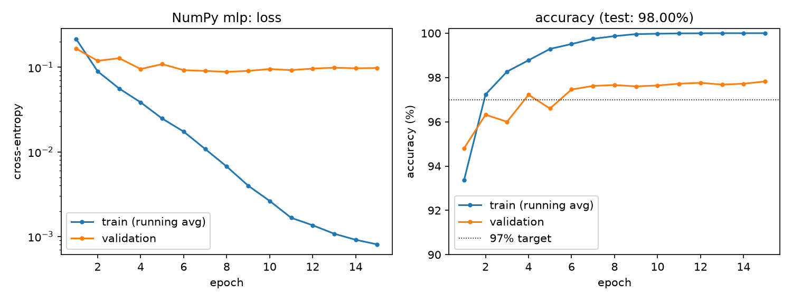
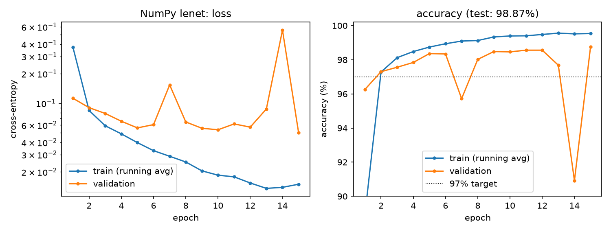
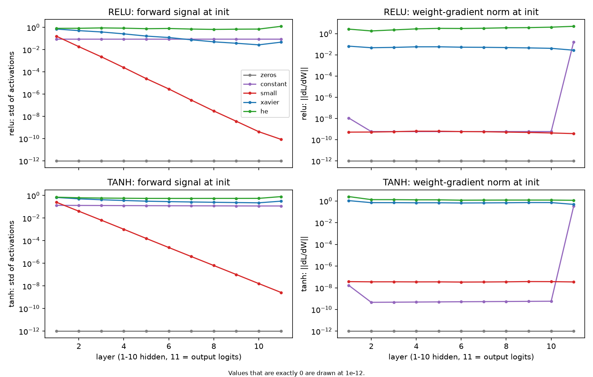
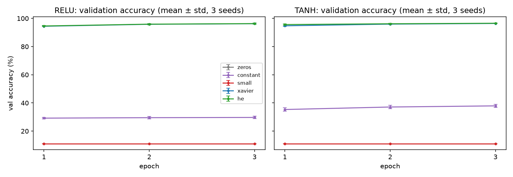
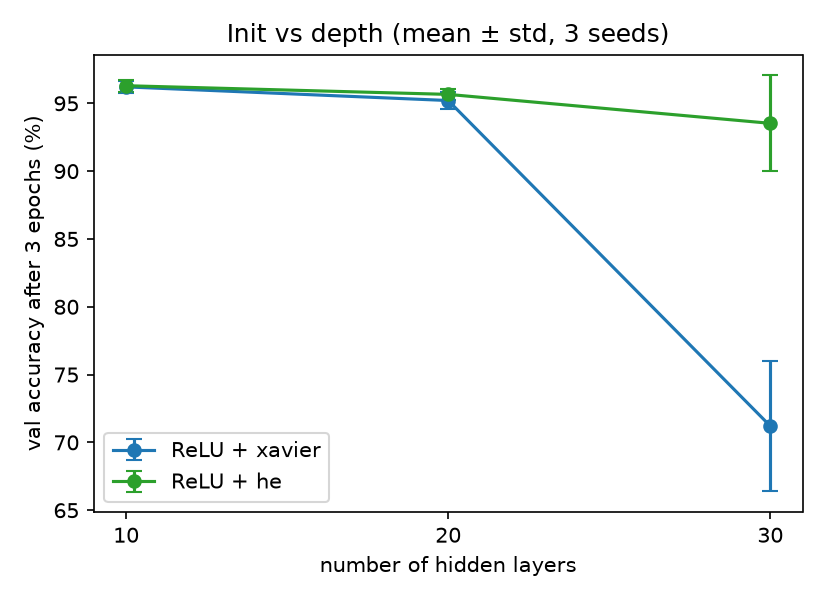
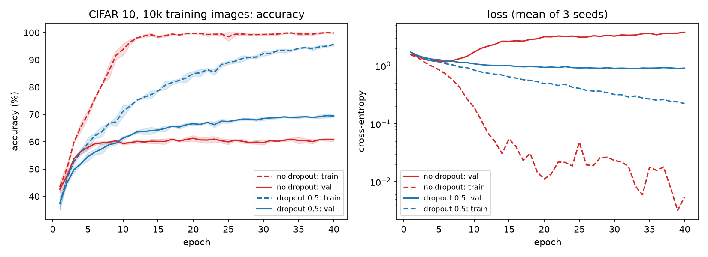
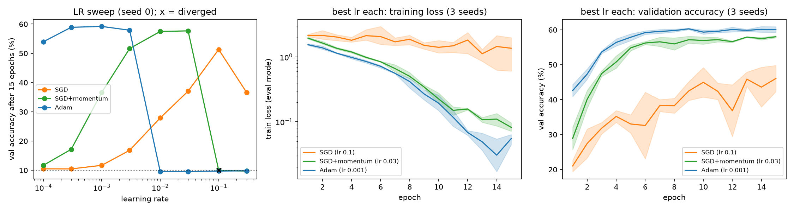

# mlp-cnn-from-scratch

An MLP and a LeNet-style CNN with **hand-written vectorized backprop in
NumPy** (including im2col convolution and max-pool), verified against finite
differences and PyTorch. They are then rebuilt in PyTorch and used for
controlled experiments on initialization, dropout and optimizers, on MNIST and
CIFAR-10.

**Summary.**
- NumPy MLP: **98.00%** MNIST test. NumPy LeNet: **98.87%** with 4× fewer
  parameters. Both are matched by the PyTorch rebuild (97.97% / 98.87%), and
  a PyTorch CNN gets 78.1% on CIFAR-10, all on a laptop CPU.
- Every layer is gradient-checked, and the full LeNet matches PyTorch's
  gradients to 1e-8. Injected bugs are caught by the tests, including one
  that finite differences alone miss.
- **Init:** zeros/constant never break symmetry; tiny init vanishes. Xavier
  on ReLU shrinks the signal √2× per layer, which is harmless at depth 10
  (96.2 vs 96.3%) and fatal at depth 30 (**71% vs He's 94%**).
- **Dropout 0.5** on 10k CIFAR images: **+8.7 points** val accuracy
  (60.7 → 69.4%). Without it, val loss bottoms out at epoch 6 and then triples.
- **Optimizers:** best lr is 1e-3 for Adam and 1e-1 for SGD (100× apart, as
  predicted). At their own best lr, Adam 60.1%, momentum 58.0%, plain SGD 46.1%.

---

## 1. What's here

```
nnlib/                      NumPy library (Parts A, B)
  layers.py                 Linear, ReLU, Dropout, Flatten, Conv2D (im2col), MaxPool2D, Sequential
  im2col.py                 im2col / col2im (its adjoint)
  losses.py                 log-sum-exp-stable softmax cross-entropy
  optim.py                  SGD (+ momentum, weight decay), same update rule as torch.optim.SGD
  gradcheck.py              central-difference gradient checker
  data.py                   MNIST (IDX) and CIFAR-10 (binary) loaders in plain NumPy
torchexp/                   PyTorch side (Part C)
  models.py                 MLP, LeNet, CifarCNN, five init schemes
  train.py                  seeded training loop, per-layer activation/gradient statistics
scripts/
  download_data.py          MNIST + CIFAR-10 with MD5 verification (no pickle files)
  train_numpy.py            Part A (--model mlp) and Part B (--model lenet)
  torch_rebuild.py          Part C: same models in PyTorch, plus a CIFAR-10 reference run
  exp_init.py, exp_init_depth.py, exp_dropout.py, exp_optim.py   the controlled experiments
tests/                      42 tests: shapes, finite differences, NumPy vs PyTorch, training-trajectory equivalence
results/                    figures, tables and JSON for every run
NOTES.md                    derivations: softmax-CE gradient, Linear/conv backward, init variance, dropout, optimizers
```

## 2. The key math in brief

| piece | forward | backward (Ā ≡ ∂L/∂A) |
|---|---|---|
| Linear | Y = XW + b | W̄ = XᵀȲ, b̄ = Σₙ Ȳₙ, X̄ = ȲWᵀ |
| ReLU | max(0, X) | Ȳ ⊙ 1[X > 0] |
| softmax-CE | L = mean(logsumexp(z) − z_y) | ∂L/∂z = (softmax(z) − onehot(y)) / N |
| Conv2D | cols = im2col(X); Y = cols W_colᵀ + b | Linear's backward on cols, then X̄ = col2im(cols̄) |
| MaxPool | max over each k×k window | route Ȳ to the argmax, 0 elsewhere |
| Dropout (inverted) | X ⊙ m/(1−p), m ~ Bernoulli(1−p) | Ȳ ⊙ m/(1−p) |
| He init | W ~ N(0, 2/fan_in) | keeps Var(activations) constant through ReLU |
| Xavier init | W ~ N(0, 2/(fan_in+fan_out)) | same for tanh/linear; half of what ReLU needs |

The softmax-CE gradient is derived step by step (short form and full-Jacobian
form) in [NOTES.md §2](NOTES.md). log-sum-exp subtracts the row max before
exponentiating, so logits of ±10⁴ are handled exactly.

## 3. Install and run

```bash
conda env create -f environment.yml && conda activate mlpcnn     # or: pip install -r requirements.txt
python -m scripts.download_data       # ~180 MB; the CIFAR-10 server can be slow
python -m pytest -q                   # 42 tests, ~2 s
./run_all.sh                          # everything below, ~3 h on a 10-core laptop CPU
```

**No GPU is needed.** Everything was run on an Apple M5 laptop CPU. The CIFAR
experiments use a 10k-image training subset and 15–40 epochs to fit a CPU
budget (the one full-data reference run takes ~1 min/epoch). Full-scale CIFAR training (all 45k images, augmentation, 100+ epochs)
would be a job for Colab/Kaggle.

## 4. Verification

| check | what it proves | result |
|---|---|---|
| finite differences (float64, h = 1e-6) | each layer's backward is consistent with its forward | rel. err < 1e-6 for Linear, ReLU, Dropout, Conv2D (4 stride/pad combos), MaxPool, Flatten, softmax-CE, and a full LeNet-style net |
| ⟨im2col(x), G⟩ = ⟨x, col2im(G)⟩ | col2im is the exact adjoint of im2col | 5 kernel/stride/pad combos |
| NumPy vs PyTorch, same weights | we compute the *same function* as the standard implementation | Linear, Conv2D, MaxPool (with ties), CE, and the **full LeNet**: loss and all 10 parameter gradients agree to 1e-8 |
| NumPy SGD vs torch.optim.SGD, 30 steps | the optimizer matches too | loss trajectories agree to 1e-9 (with and without momentum) |

**The tests catch real bugs.** Each of these was injected on purpose (measured when the suite had 37 tests; the 5 added later are data and equivalence tests):

| injected bug | tests failing |
|---|---|
| col2im overwrites instead of adding (`=` for `+=`) | 13 / 37 |
| im2col swaps kernel rows and columns | 15 / 37 (**only** the PyTorch comparisons; finite differences can't see it, because the function stays self-consistent) |
| CE gradient missing the 1/N | 4 / 37 |
| Linear's bias gradient uses a mean instead of a sum | 4 / 37 |
| max-pool backward missing the inverse transpose | 4 / 37 |

## 5. Part A: NumPy MLP on MNIST

784 → 256 → 128 → 10, ReLU, He init, **plain mini-batch SGD** (lr 0.1, batch
64), 15 epochs. 55k train / 5k validation (fixed split); test set used once.

| model | params | test acc | test loss | s / epoch |
|---|---|---|---|---|
| **NumPy MLP** | 235,146 | **98.00%** | 0.076 | 1.2 |



- The ≥ 97% target is met at epoch 4 on validation; final test accuracy is 98.0%.
- **Mild overfitting shows up in the loss before the accuracy.** Validation
  loss is lowest at epoch 8 (0.088) and then rises to 0.098, while training
  loss falls to 0.0008 and training accuracy reaches 100%. Validation accuracy
  keeps creeping up (97.7 → 97.8%). The model is becoming over-confident on
  the examples it gets wrong.
- The initial loss is 2.90, above log 10 = 2.30. He init on the output layer
  gives logits with std 1.5, so the network starts out confidently wrong
  (NOTES.md §2).

## 6. Part B: NumPy LeNet (im2col convolution)

conv5×5(6, pad 2) → ReLU → maxpool → conv5×5(16) → ReLU → maxpool → 400 → 120
→ 84 → 10. Same recipe as Part A.

| model | params | test acc | test loss | s / epoch |
|---|---|---|---|---|
| NumPy MLP | 235,146 | 98.00% | 0.076 | 1.2 |
| **NumPy LeNet** | **61,706** | **98.87%** | 0.047 | 10.5 (uncontended) |



LeNet is **more accurate with 4× fewer parameters**. Weight sharing and
locality are the right inductive bias for images. It also overfits less:
training accuracy ends at 99.5% rather than 100%, and validation loss is still
falling at epoch 15. "Slow is fine" turned out to be unnecessary: im2col makes
an epoch take about 10 s in pure NumPy.

## 7. Part C: the same models in PyTorch

Same architectures, same He init, and the same recipe as Parts A and B
(SGD lr 0.1, batch 64, 15 epochs, same split). A CIFAR-10 reference run uses
the VGG-style `CifarCNN` on all 45k training images.

| model | NumPy test acc | PyTorch test acc | NumPy s/epoch | PyTorch s/epoch |
|---|---|---|---|---|
| MLP, MNIST | 98.00% | 97.97% | 1.2 | 0.6 |
| LeNet, MNIST | 98.87% | 98.87% | 10.5 | 5.3 |
| CifarCNN (dropout 0.5, Adam 1e-3), CIFAR-10, 45k train | — | **78.09%** | — | 57.5 |

The two implementations reach the same accuracy. They don't match exactly
because their RNG streams for init and shuffling differ. Starting from
*identical* weights, `tests/test_equivalence.py` shows they produce the same
trajectory to 1e-9. NumPy is only about 2× slower: im2col turns convolution
into one big BLAS matmul, the same thing PyTorch does on CPU.

All experiments below use **fixed seeds 0–2, a fixed train/val split, the
same budget per run, and validation data only**. The test set is not used at
all in Part C experiments.

### C1. Initialization (MNIST, 10-hidden-layer MLP, width 256)

**Hypothesis.** Zeros and constant init can't break symmetry, so every unit in
a layer stays identical. Tiny random init (N(0, 0.01²)) makes the signal
vanish exponentially with depth. Xavier keeps the variance constant for tanh
but halves it at every ReLU layer. He keeps it constant for ReLU.

**Setup.** relu and tanh × {zeros, constant 1/fan_in, small, xavier, he} ×
3 seeds. SGD lr 0.01, momentum 0.9, batch 128, 3 epochs. Per-layer statistics
are measured at init on 512 images. "Unit diversity" is the mean std across
the units of a layer (0 means all units are copies).




| activation | init | act std, layer 1 → 10 | ‖dL/dW‖, layer 1 → 10 | val acc after 3 epochs (%) | unit diversity |
|---|---|---|---|---|---|
| relu | zeros | 0 → 0 | 0 → 0 | 11.1 ± 0.0 | 0 |
| relu | constant | 0.088 → 0.088 | 1.1e-8 → 5.9e-10 | 29.7 ± 0.9 | 0 |
| relu | small | 0.16 → 4.3e-10 | 5.2e-10 → 4.3e-10 | 11.1 ± 0.0 | 0.01 |
| relu | xavier | 0.71 → 0.027 | 0.066 → 0.041 | 96.2 ± 0.4 | 0.063 |
| relu | he | 0.82 → 0.71 | 2.7 → 4 | 96.3 ± 0.4 | 0.088 |
| tanh | zeros | 0 → 0 | 0 → 0 | 11.1 ± 0.0 | 0 |
| tanh | constant | 0.13 → 0.12 | 1.7e-8 → 5.8e-10 | 37.9 ± 1.2 | 0 |
| tanh | small | 0.25 → 1.6e-8 | 3.7e-8 → 3.7e-8 | 11.1 ± 0.0 | 0.01 |
| tanh | xavier | 0.67 → 0.23 | 1.1 → 0.71 | 96.4 ± 0.2 | 0.063 |
| tanh | he | 0.71 → 0.56 | 2.5 → 1.2 | 96.6 ± 0.2 | 0.088 |

(In `training.png` the zeros and small curves sit exactly on top of each
other at 11.1%, the frequency of the most common validation class.)

**Conclusions.**
- **Symmetry is confirmed.** With zeros, every gradient except the last
  bias is exactly 0. With constant init, diversity stays at **exactly 0**
  after training, so each layer behaves like a single unit. It still gets
  30–38%, because the output bias and output layer can learn something. Its
  hidden-layer gradients are ~1e-9 for a neat reason: every hidden unit is
  equal, so ∂L/∂h ∝ Σₖ(pₖ − yₖ)·c = 0 (NOTES.md §4).
- **Vanishing signal is confirmed.** With small init, activations shrink about
  10× per layer (0.16 → 4e-10). The network outputs a constant and never
  leaves chance.
- **ReLU + Xavier shrinks as predicted:** activations go from 0.71 to 0.027,
  close to the √2-per-layer factor (√2⁹ ≈ 23; measured 26). He keeps them flat
  (0.82 → 0.71). **But at depth 10 it doesn't hurt accuracy (96.2 vs 96.3).**
  Momentum and a 3-epoch budget are enough to recover. That called for a
  stress test.

### C1b. Initialization vs depth

**Hypothesis.** The Xavier shrinkage is exponential in depth, so the gap
to He should open up as the network gets deeper.

**Setup.** ReLU, depth ∈ {10, 20, 30}, xavier vs he, 3 seeds, otherwise as in C1.



| depth | init | logit std at init | ‖dL/dW₁‖ at init | val acc after 3 epochs (%) |
|---|---|---|---|---|
| 10 | xavier | 0.046 | 0.074 | 96.2 ± 0.4 |
| 20 | xavier | 0.0014 | 0.0022 | 95.2 ± 0.6 |
| 30 | xavier | 5.7e-5 | 7e-5 | **71.2 ± 4.8** |
| 10 | he | 1.2 | 3 | 96.3 ± 0.4 |
| 20 | he | 1.2 | 2.4 | 95.7 ± 0.4 |
| 30 | he | 1.5 | 4.1 | **93.5 ± 3.5** |

**Conclusion: confirmed.** With Xavier, the logit std falls about 32× per
10 layers (√2¹⁰ = 32), and the first-layer gradient falls with it. At depth 30
it is 7e-5, and accuracy collapses to 71%. With He, both stay O(1) at every
depth. He et al. (2015) derived exactly this factor of 2 for ReLU and needed
it to train their 30-layer plain nets.

### C2. Dropout (CIFAR-10)

**Hypothesis.** With only 10k training images, the CNN memorises the
training set. Dropout 0.5 lowers training accuracy, narrows the train–val gap,
and **raises** validation accuracy (Srivastava et al. 2014).

**Setup.** `CifarCNN` (p/2 after each conv block, p before the FC layers),
p ∈ {0, 0.5}, Adam lr 1e-3, batch 128, **40 epochs** (long enough to see
overfitting develop), 3 seeds. Training metrics are measured in eval mode
(dropout off), so the two are comparable.



| dropout p | final train acc | final val acc | best val acc (epoch) | gap train−val at end | min val loss (epoch) | final val loss |
|---|---|---|---|---|---|---|
| 0.0 | 99.8 ± 0.3 | 60.7 ± 0.6 | 61.6 (18) | 39.1 | 1.17 (6) | 3.79 |
| 0.5 | 95.6 ± 0.5 | **69.4 ± 0.5** | 69.7 (38) | 26.2 | 0.89 (34) | 0.91 |

**Conclusion: confirmed on every count.**
- **Without dropout, the textbook overfitting picture appears.** Training
  accuracy hits ~100% by epoch 12. Validation accuracy plateaus at ~60% by
  epoch 8. Validation loss is lowest at **epoch 6** and then more than
  triples (1.17 → 3.79) as the model grows confidently wrong on unseen
  images.
- **With dropout, validation accuracy is +8.7 points higher** (69.4 vs 60.7;
  the seed std is about 0.5, so this isn't noise). Its validation loss is
  still flat-to-falling at epoch 40, and the gap is 13 points smaller.
- Dropout narrows the gap but doesn't close it: 26 points remain. A
  10k-image training set is the real limit. Compare the 78% from the
  full-data run in §7. More data (or augmentation) is the bigger lever.
- Cost: dropout learns more slowly. It is *behind* for the first ~9 epochs.
  Under a short budget (≤ 8 epochs), turning dropout off would look better.

### C3. Optimizers and the learning-rate sweep (CIFAR-10)

**Hypotheses.** (H1) Each optimizer has a different best lr, with Adam's ~100×
below SGD's, because Adam's step is ≈ lr in parameter units. (H2) Momentum
0.9 acts like a 10× larger lr, so its best lr is ~10× below plain SGD's. (H3)
At its own best lr, each of momentum and Adam beats plain SGD within a fixed
budget.

**Setup.** `CifarCNN` without dropout, 10k images, batch 128, 15 epochs.
Stage 1: 8 learning rates from 1e-4 to 3e-1 × 3 optimizers, seed 0. Stage 2:
each optimizer at its best lr (by final val accuracy) on seeds 0–2.



Val accuracy (%) after 15 epochs, seed 0. Bold is the selected lr; "div." means the loss became NaN.

| optimizer | 1e-4 | 3e-4 | 1e-3 | 3e-3 | 1e-2 | 3e-2 | 1e-1 | 3e-1 |
|---|---|---|---|---|---|---|---|---|
| SGD | 10.5 | 10.5 | 11.7 | 16.8 | 27.9 | 37.1 | **51.3** | 36.6 |
| SGD+momentum | 11.7 | 17.2 | 36.7 | 51.6 | 57.5 | **57.7** | div. | 9.7 |
| Adam | 54.0 | 58.9 | **59.2** | 57.9 | 9.6 | 9.6 | 9.7 | 9.8 |

| optimizer | best lr | val acc, 3 seeds | final train loss |
|---|---|---|---|
| SGD | 0.1 | 46.1 ± 4.6 | 1.368 |
| SGD+momentum | 0.03 | 58.0 ± 0.4 | 0.082 |
| Adam | 0.001 | **60.1 ± 1.0** | 0.055 |

**Conclusions.**
- **H1 is confirmed.** The best lr is 1e-3 for Adam and 1e-1 for SGD,
  exactly 100× apart. At any single shared lr the ranking flips: Adam wins at
  1e-3, while at 1e-1 plain SGD wins and the others are dead. **A
  one-learning-rate comparison of optimizers says nothing.**
- **H2 is partly confirmed.** On the rising (too-small-lr) side, momentum's
  curve is shifted left by a decade or more, as predicted. Momentum at 1e-3
  gets 36.7, and SGD needs 3e-2 for 37.1. The *best* lr is only 3× apart
  (0.03 vs 0.1), though. Plain SGD gets unstable (0.3 is worse) before it
  reaches the 10× equivalent of momentum's optimum. The "momentum = 10× lr"
  rule describes the low-curvature regime, not the edge of stability.
- **H3 is confirmed.** Adam reaches 60.1 ± 1.0 and momentum 58.0 ± 0.4, against
  plain SGD's 46.1 ± 4.6. SGD's train loss (1.37) shows it is still
  *underfitting* after 15 epochs. Its curves are also very noisy: at lr 0.1 it
  is near the edge of stability, which accounts for the large seed variance.
  Adam vs momentum (2 points with 3 seeds) is a small edge, not a decisive one.
- **Selection bias, visible in the data.** SGD's seed-0 run (51.3) was
  *chosen* because it was the best of 8. Seeds 1 and 2 at the same lr got 42.8
  and 44.1. That is the winner's curse, and it is why stage 2 re-runs on new
  seeds rather than reporting the sweep's maximum.
- **Adam is the most forgiving.** It stays within 5 points across a 30×
  range (1e-4 to 3e-3). Above that it fails *silently*: at lr ≥ 1e-2 the
  loss never becomes NaN, so the divergence check doesn't fire, but the
  network collapses to a constant output (9.6%, dead ReLUs). A NaN check
  alone is not enough monitoring.

## 8. What I learned

- **Writing backward by hand forces you to understand shapes.** Every
  gradient has the shape of the thing it differentiates, and most backward
  passes are "the forward matmul, transposed".
- **Finite differences are necessary but not sufficient.** A kernel-flipped
  im2col passes every gradient check, because forward and backward are
  consistently wrong. Only comparing against PyTorch caught it.
- **Init is a variance-propagation problem.** The √2 per ReLU layer is
  invisible at depth 10 and decisive at depth 30. Measure activation and
  gradient statistics at init before training anything.
- **Overfitting shows up in val loss first**, several epochs before val
  accuracy stops improving (epoch 6 vs ~18 in C2).
- **Hyperparameters can't be compared at one setting.** Each optimizer needs
  its own lr sweep, and the winner needs fresh seeds to avoid the winner's
  curse.

## 9. Limitations

- **Small budgets.** The CIFAR experiments use 10k images and 15–40 epochs on
  a CPU. The absolute numbers (60–70%) are far below the state of the art,
  and conclusions about *rates* (e.g. SGD underfitting) are budget-dependent.
  With a learning-rate schedule and 100+ epochs, plain SGD would close much of
  the gap.
- **Three seeds** give rough error bars only. Differences under ~2 points
  (Adam vs momentum; Xavier vs He at depth ≤ 20) should not be over-read.
- The lr sweep is done on **one seed** with half-decade steps. The true optima
  could sit between grid points.
- No data augmentation, batch norm, weight decay or lr schedules. Each would
  interact with the effects studied here (batch norm in particular makes
  init matter much less).
- The NumPy library is CPU-only and single-threaded apart from BLAS. It is
  for understanding, not speed.

## 10. References

- Y. LeCun, L. Bottou, Y. Bengio, P. Haffner. *Gradient-based learning applied to document recognition.* Proc. IEEE, 1998. (LeNet)
- X. Glorot, Y. Bengio. *Understanding the difficulty of training deep feedforward neural networks.* AISTATS 2010. (Xavier init)
- K. He, X. Zhang, S. Ren, J. Sun. *Delving deep into rectifiers.* ICCV 2015. (He init)
- N. Srivastava, G. Hinton, A. Krizhevsky, I. Sutskever, R. Salakhutdinov. *Dropout: a simple way to prevent neural networks from overfitting.* JMLR 2014.
- D. P. Kingma, J. Ba. *Adam: a method for stochastic optimization.* arXiv 2014 / ICLR 2015.
- A. Krizhevsky. *Learning multiple layers of features from tiny images.* Tech. report, 2009. (CIFAR-10)
- S. Ioffe, C. Szegedy. *Batch normalization.* ICML 2015. (Not used; see Limitations.)
